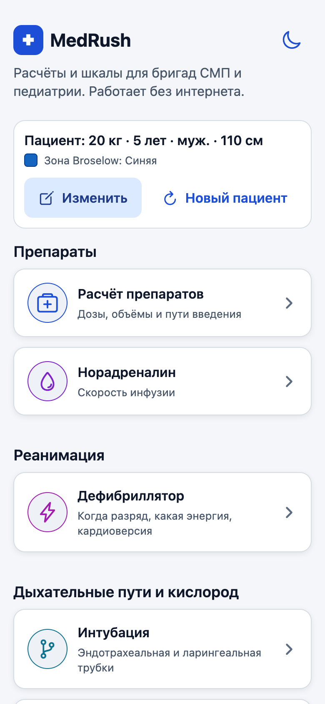
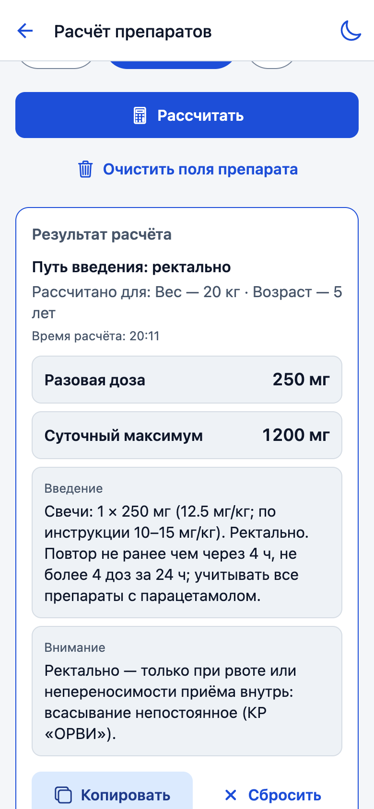
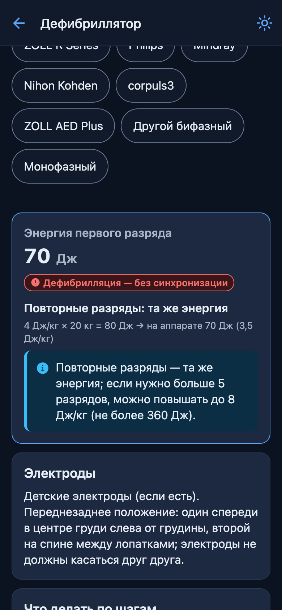
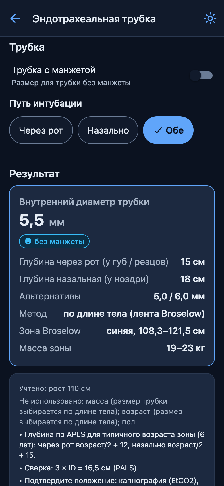

<div align="center">


# DocHub

**Справочник и калькуляторы для бригад скорой помощи и педиатров.**<br>
Дозы препаратов, дефибрилляция, трубки, кислород и ИВЛ, клинические шкалы и МКБ-10 — без интернета.

[](https://github.com/Tishe698/DocHub/actions/workflows/ci.yml)


[](LICENSE)

</div>

<table>
  <tr>
    <td align="center"><br><sub>Главный экран и общий пациент</sub></td>
    <td align="center"><br><sub>Парацетамол ректально, 20 кг</sub></td>
    <td align="center"><br><sub>Энергия разряда на LIFEPAK 15</sub></td>
    <td align="center"><br><sub>Трубка по ленте Broselow</sub></td>
  </tr>
</table>

> [!WARNING]
> Расчёты справочные. Приложение не заменяет клинические рекомендации, инструкцию к препарату
> и решение врача. Перед применением сверяйте дозу, концентрацию и путь введения с инструкцией,
> а размер трубки — с маркировкой производителя.

## Что умеет

Данные пациента вводятся один раз — масса, возраст, пол, рост, зона ленты Broselow — и сами
подставляются во все калькуляторы. Массу можно оценить по возрасту или по ленте Broselow.

| Раздел | Что считает |
|---|---|
| **Расчёт препаратов** | 128 препаратов, у 122 есть расчёт дозы и объёма. Путь введения и показание выбираются кнопками, доза не превышает максимум, результат копируется для карты вызова. Поиск по МНН и привычным названиям: «анальгин», «реланиум», «лазикс». |
| **Норадреналин** | Доза по основанию, скорость шприцевого насоса (мл/ч) и капельницы (кап/мин). |
| **Дефибриллятор** | Нужен ли разряд и какой, энергия для взрослого и ребёнка на ступенях конкретного аппарата: LIFEPAK 15, ZOLL, Аксион, Philips, Mindray, Nihon Kohden, corpuls3. Кардиостимуляция при брадикардии, электроды, действия по шагам. |
| **Интубация** | Эндотрахеальная трубка: размер и глубина через рот и нос по росту, зоне Broselow, возрасту или массе. Ларингеальная трубка VBM LT / LTS-D. |
| **Кислород и ИВЛ** | Время работы баллона до резерва, минутный объём по Дарбиняну, стартовые параметры MEDUMAT Standard / Standard² и А-ИВЛ/ВВЛ/ВЧп-4/40. |
| **Шкалы** | NEWS2, шкала комы Глазго (взрослая и детская), шоковый индекс Альговера и SIPA, пересмотренная Женевская шкала (ТЭЛА), ШОКС при ХСН. |
| **Педиатрия** | Нормы по возрасту (масса, рост, ЧДД, ЧСС, АД, порог гипотензии), шкала Апгар с секундомером от рождения. |
| **Справочники** | МКБ-10 (11 841 запись, поиск по коду и названию), группа крови по таблице цоликлонов, срок беременности и дата родов. |

Ещё в приложении:

- **Работает без сети.** Препараты, нормы и МКБ-10 хранятся внутри приложения.
- **Светлая и тёмная тема.** Значок луны или солнца в правом верхнем углу; долгое нажатие
  возвращает тему телефона.
- **Доступность.** Подписи для TalkBack и VoiceOver на русском, результат озвучивается,
  крупный системный шрифт до 150 %.
- **Без учётных записей.** Данные пациента хранятся только в памяти и стираются при закрытии;
  истории расчётов и передачи данных нет.

Подробная инструкция по каждому экрану и полный список препаратов — в
[USER_GUIDE.md](USER_GUIDE.md).

## Откуда берутся цифры

Приоритет источников:

1. Действующие клинические рекомендации МЗ РФ, приказы МЗ РФ.
2. Инструкции к препаратам, зарегистрированным в РФ (ГРЛС).
3. Если российского источника нет — ERC, AHA/PALS, BNF for Children, оригинальные публикации шкал,
   документация производителей трубок, аппаратов ИВЛ и дефибрилляторов.

Если источники расходятся, берётся российский вариант, а без него — самый осторожный. У каждой
дозы, предела и порога в коде есть комментарий с документом, годом и разделом.

**Проверка.** В октябре 2026 года все расчёты прошли аудит: 428 позиций сверены с источниками
и проверены запуском кода. Найденные расхождения исправлены, а то, что оставлено сознательно,
объяснено в коде. Расчёты покрыты автотестами (Jest), CI проверяет каждый
pull request. Клиническую валидацию расчёты не проходили: перед выпуском дозы, пороги и тексты
должен подтвердить врач.

<details>
<summary><b>Источники по разделам</b></summary>

| Раздел | Основные источники |
|---|---|
| Расчёт препаратов | Инструкции ГРЛС; КР МЗ РФ: «Анафилактический шок» 2025, «Сепсис у взрослых» 2024, «Фибрилляция и трепетание предсердий» 2025, «Наджелудочковые тахикардии» 2025, «Эпилепсия и эпилептический статус» 2022, «Круп» 2021, «ОРВИ», «Менингококковая инфекция у детей» 2023 и др.; приказы № 1165н и № 424н (укладки СМП); ERC 2021 и 2025; PALS 2020; BNF for Children |
| Норадреналин | Инструкции ГРЛС; PALS 2020 (дети) |
| Дефибриллятор | КР МЗ РФ «Остановка сердца (взрослые)» 2025; КР МЗ РФ по нарушениям ритма 2025; ERC 2025; инструкции производителей аппаратов |
| Эндотрахеальная трубка | PALS 2020, ERC 2021, APLS; лента Broselow-Luten 2017; NRP (новорождённые) |
| Ларингеальная трубка | Инструкция VBM LTS-D (2017). К ларингеальной маске и i-gel не относится |
| Время работы баллона | ГОСТ 5583-78; резерв 14 атм — консервативная практика СМП, его можно изменить |
| Формула Дарбиняна | Дарбинян Т.М. (1976): МОД = масса / 10 + 1 л/мин; при массе меньше 5 кг не применяется |
| Аппаратная ИВЛ | ERC 2021, ERC-ESICM 2021, ARDSNet (2000), PEMVECC 2017, руководства производителей аппаратов |
| NEWS2 | Royal College of Physicians, NEWS2 (2017); МР МЗ РФ по COVID-19 у беременных, версия 5 (2021) |
| Шкала Глазго | КР МЗ РФ «Черепно-мозговая травма у детей»; Teasdale 2014; Brennan 2018 |
| Шоковый индекс | Allgöwer (1967); SIPA — Acker 2015, Nordin 2017; КР МЗ РФ «Послеродовое кровотечение» 2021; PALS 2020 |
| Шкала ТЭЛА | Le Gal 2006; ESC 2019 |
| ШОКС | КР МЗ РФ «Хроническая сердечная недостаточность» 2024, приложение Г1 |
| Нормы в педиатрии | Мазурин А.В., Воронцов И.М. «Пропедевтика детских болезней»; PALS 2015/2020 |
| Шкала Апгар | Методические письма МЗ РФ 2010 и 2020; МКБ-10 P21; AAP/ACOG 2015 |
| Группа крови | Приказы МЗ РФ № 1134н (2020) и № 363 (2002) |
| Срок беременности | КР МЗ РФ «Нормальная беременность» 2023, «Преждевременные роды» 2024 |

</details>

## Запуск

Нужны **Node.js 22** (версия в `.nvmrc`) и npm. Для нативной сборки — Android Studio или Xcode
(только macOS).

```bash
git clone https://github.com/Tishe698/DocHub.git
cd DocHub
nvm use        # Node из .nvmrc
npm ci         # зависимости строго по package-lock.json

npm start      # Metro и QR-код для Expo Go
npm run android
npm run ios
npm run web    # веб-версия в браузере
```

В Expo Go видео на экране «Срок беременности» может не воспроизводиться, в собранном приложении
оно работает.

### Сборка

```bash
npx eas build --platform android --profile preview      # APK для установки
npx eas build --platform android --profile production   # сейчас тоже APK (см. eas.json)
npx eas build --platform ios --profile production
```

Для Google Play нужен AAB: в профиле `production` файла `eas.json` замените
`"buildType": "apk"` на `"buildType": "app-bundle"`.

## Разработка

| Команда | Что делает |
|---|---|
| `npm test` | Jest (`jest-expo`); тесты лежат рядом с кодом в папках `__tests__/` |
| `npx jest <путь>` | тесты одного модуля, например `npx jest defibrillation` |
| `npm run lint` | ESLint 9 с правилами хуков React |
| `npm run format` / `npm run format:check` | Prettier 3: исправить или только проверить |

**CI** ([`.github/workflows/ci.yml`](.github/workflows/ci.yml)) запускается на каждый pull request
и push в `main`: `npm ci` → линтер → форматирование → тесты → пробная сборка Android-бандла.

<details>
<summary><b>Правила для изменений</b></summary>

1. Логика расчёта — в чистом модуле рядом с экраном (без React), тест — в `__tests__/` рядом.
2. Новый экран: папка модуля → маршрут в `ROUTES` в `App.js` → карточка в
   `main_screen/menuConfig.js`. Тест `menuConfig.test.js` упадёт, если у маршрута нет карточки.
3. Экран собирается из `components/Screen` и `components/ui`, цвета — только из
   `useTheme().colors`, данные пациента — из `patient/PatientContext`.
4. Новый препарат — запись в нужном файле `js_button_preparation/formula_groups/`. Путь введения —
   `routeInput([...], 'iv')`, показание — `choiceInput(...)` из `js_button_preparation/routes.js`.
5. У каждого клинического значения (доза, максимум, порог, строка таблицы) — комментарий
   с источником: документ, год, раздел.
6. Перед pull request: `npm run lint`, `npm test`, `npm run format:check`; обновите документацию.

Подробнее — в [docs/ARCHITECTURE.md](docs/ARCHITECTURE.md): тема, компоненты, доступность, общий
пациент, пути введения, тесты.

</details>

<details>
<summary><b>Структура проекта</b></summary>

```
DocHub/
├── App.js                    # Провайдеры и навигация (native-stack), маршруты ROUTES
├── theme/                    # Светлая и тёмная палитры, токены, ThemeProvider, лента Broselow
├── components/               # Screen, AppText, a11y и ui/ (кнопки, поля, карточки, ThemeToggle, HelpButton)
├── patient/                  # Общий пациент: контекст, оценка массы (APLS, Broselow), полоса и редактор
├── main_screen/              # Главный экран и меню (menuConfig.js)
├── js_button_preparation/    # Расчёт препаратов: экран, движок engine.js, пути введения,
│   └── formula_groups/       #   19 групп препаратов
├── Norepinephrine/           # Норадреналин
├── defibrillation/           # Дефибриллятор: логика и аппараты (devices.js)
├── button_two/               # Эндотрахеальная и ларингеальная трубки
├── calculate_o2/             # Баллон, Дарбинян, аппаратная ИВЛ
├── news/ glazgo/ shock_index_algovera/ Tela/ shoks/   # Шкалы
├── fiz_norm/ apgar/          # Нормы в педиатрии, шкала Апгар
├── mkb10/ blood_group/ pregnancy/                      # Справочники
├── docs/                     # ARCHITECTURE.md, скриншоты
└── .github/workflows/ci.yml  # CI
```

Карта всех экранов, маршрутов и модулей — в [APP_MAP.md](APP_MAP.md).

</details>

<details>
<summary><b>Технологии</b></summary>

- Expo SDK 54 (`expo ~54.0.37`), React Native 0.81.5, React 19.1, JavaScript;
- React Navigation 7 (native-stack), react-native-safe-area-context;
- AsyncStorage — только для выбранной темы; expo-clipboard — копирование результата;
- expo-video — видео на экране «Срок беременности»; datetimepicker — выбор даты;
- Jest 29 + jest-expo, ESLint 9, Prettier 3.

</details>

## Документация

| Файл | Для кого |
|---|---|
| [USER_GUIDE.md](USER_GUIDE.md) | Инструкция по каждому экрану и список препаратов |
| [APP_MAP.md](APP_MAP.md) | Карта экранов, маршрутов и модулей |
| [docs/ARCHITECTURE.md](docs/ARCHITECTURE.md) | Руководство разработчика |

## История версий

<details>
<summary><b>v2.0.0 — текущая</b></summary>

- Главный экран из шести разделов и общий пациент для всех калькуляторов.
- Калькулятор препаратов: 128 записей, пути введения и показания, пределы доз, расшифровка
  сокращений, поиск по привычным названиям.
- Новые экраны: Дефибриллятор, NEWS2, шкала Апгар; группа крови по таблице цоликлонов.
- Светлая и тёмная тема со значком в шапке, доступность для TalkBack и VoiceOver.
- Аудит всех расчётов и исправления по клиническим рекомендациям; автотесты, ESLint, Prettier, CI.
- Видео на экране беременности сжато с 34,7 до 11,3 МБ.

</details>

<details>
<summary><b>v1.0.0</b></summary>

- Первый релиз: базовые расчёты, МКБ-10, педиатрические нормы.
- [APK на Expo](https://expo.dev/artifacts/eas/9MKdaFnSxotn5m1b2zsj3C.apk) — ранее опубликованная
  сборка, без изменений v2.0.0. Актуальную версию соберите из исходников.

</details>

## Лицензия и контакты

[MIT](LICENSE).

- **Email:** govard6981@outlook.com
- **Telegram:** @Ivan_tishe
